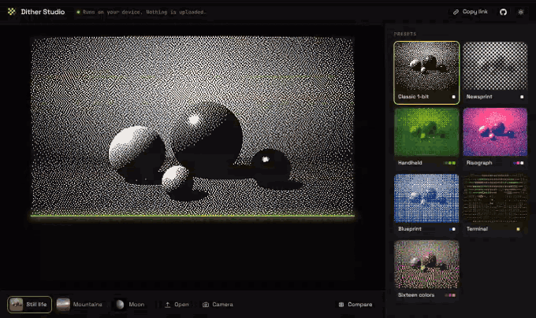
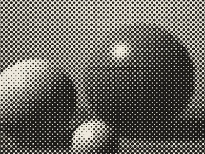
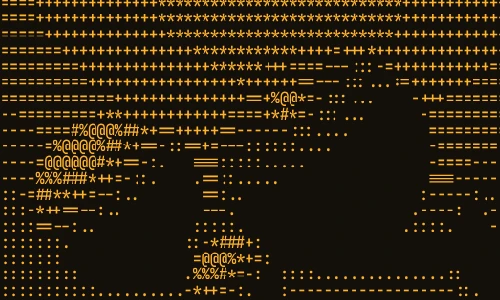

# Dither Studio

[](https://github.com/rezaaryam/dither-studio/actions/workflows/test.yml)


Turn photos, video, and your camera into 1-bit art, newspaper halftone, risograph tones, and ASCII. Export a sharp PNG, a clean SVG, or an animated GIF. Everything runs in your browser; nothing is uploaded.

**[Open the studio](https://rezaaryam.github.io/dither-studio/)**



## What you can do

- **Pick a look in one click.** Seven presets, each previewed live on your own image: Classic 1-bit, Newsprint, Handheld, Risograph, Blueprint, Terminal, and Sixteen colors.
- **Or build your own.** Eleven algorithms, any palette of 2 to 16 colors, pixel size, and tone controls for brightness, contrast, gamma, sharpening, and invert.
- **Use any source.** The built-in samples, an image or video you open, drop, or paste, or your camera at full frame rate.
- **Compare.** Drag the slider (or press <kbd>C</kbd>) to see the original next to the result.
- **Export.** PNG at 1×, 2×, or 4× with crisp pixels; SVG as merged pixel runs, halftone circles, or text; GIF as a single frame or a 3-second recording from the camera or a video.
- **Share.** "Copy link" puts every setting in the URL, so a look can be passed around.

| Halftone, up close | ASCII, up close |
|---|---|
|  |  |

## How it works

```
docs/studio.js   UI: sources, controls, drawing, exports
docs/worker.js   runs the core off the main thread
src/dither.js    the image core, pure functions (also used by the UI for palettes and SVG)
src/gif.js       GIF89a encoder with LZW, written from scratch
```

**Dithering.** Error diffusion spreads each pixel's rounding error to its neighbours with the classic kernels (Floyd-Steinberg, Atkinson, Jarvis-Judice-Ninke, Stucki, Burkes, Sierra Lite), scanning in a serpentine order to avoid diagonal streaks. Ordered dithering uses recursively built Bayer matrices. For two-tone and multi-tone palettes the image is mapped onto a brightness ramp; in full-color mode each pixel finds its nearest palette color in weighted RGB and the error is diffused per channel.

**Halftone.** A screen of dots is laid out on a grid rotated to the chosen angle. Each dot's area matches the average darkness under it, the same rule a print shop uses.

**GIF.** Dithered frames already use a palette of 16 colors or fewer, so there is no quantization step: palette indices go straight into the LZW compressor. The tests decode every GIF the encoder writes, including a 320×240 noise frame that forces dictionary resets, and the output was also checked against Pillow's decoder.

**Speed.** All pixel work happens in a Web Worker, so sliders stay smooth while an image is being processed, and the camera feed keeps running while you change settings.

## Run it locally

```bash
git clone https://github.com/rezaaryam/dither-studio.git
cd dither-studio
npm start            # serves docs/ at http://localhost:3000
```

The camera needs `https` or `localhost`.

## Use the core in your own code

```js
const D = require("./src/dither.js"); // or <script src="dither.js"> for window.DitherCore

const result = D.process(imageData.data, width, height, {
  mode: "pixel",
  algorithm: "atkinson",
  palette: ["#111111", "#f4f1ea"]
});
// result.indices is a Uint8Array of palette indices, one per pixel
const svg = D.svgFromIndices(result.indices, width, height, D.makePalette(["#111111", "#f4f1ea"]), 2);
```

```js
const Gif = require("./src/gif.js");
const bytes = Gif.encode({ width, height, palette: [[17, 17, 17], [244, 241, 234]], frames: [result.indices], delay: 80 });
```

## Development

```bash
npm install
npx playwright install chromium   # once
npm test                          # 36 tests: core, GIF round trip, and the app in a real browser
npm run sync                      # copy src/ into docs/ after changing the core
npm run samples                   # re-render the sample images (needs Python, numpy, Pillow)
```

The browser tests use Chromium's fake camera, so the GIF recorder is tested without hardware.

## Notes

- The sample images are rendered by `scripts/make-samples.py` (a small ray tracer, layered ridges, and a cratered moon), so the repo contains no third-party photos.
- Built only on standard APIs (Web Workers, canvas, `getUserMedia`) available in current Chrome, Edge, Firefox, and Safari. The automated tests run in Chromium.

## License

Code: MIT © Reza Arya Maulana. Fonts in `docs/fonts/` (Space Grotesk, JetBrains Mono) are under the SIL Open Font License.
